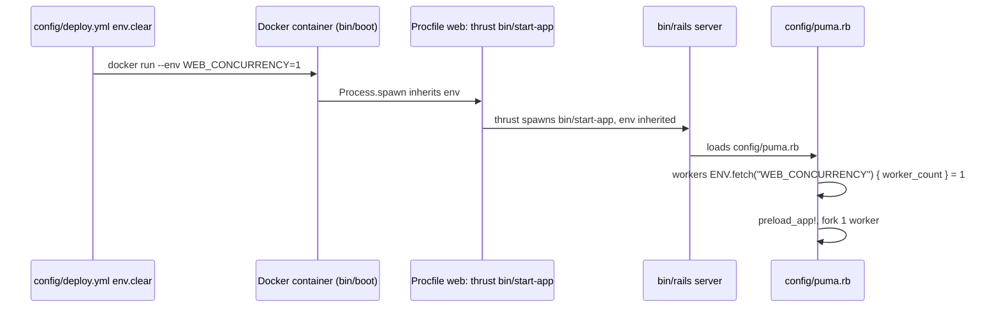

# Plan: Run one Puma worker in production

From `intent.md` (2026-10-26). Status: accepted.

## Design

### Domain terms

Not affected: a deploy configuration change introduces no domain term. `GLOSSARY.md` does not exist, and no word of the intent conflicts with an agreed term.

### Diagrams

The path by which `WEB_CONCURRENCY` reaches Puma in production. Only the first box changes.



### Signatures

Not affected: no Ruby class or method changes.

Not checked: no Ruby signature is touched, so there is nothing for Steep to check.

### Complexity

Not affected: no request path changes. Request concurrency drops from 2 workers x 5 threads to 1 worker x 5 threads, which is ample for 2 to 5 users.

### Invariants

- Production runs exactly one Puma worker in cluster mode, enforced by `WEB_CONCURRENCY: "1"` in `config/deploy.yml` `env.clear`, which `config/puma.rb` line 36 reads before its computed default.
- `JOB_CONCURRENCY` stays at the computed worker count (2), because `config/puma.rb` line 38 reads `worker_count`, not `WEB_CONCURRENCY`. Nothing in the repository reads `JOB_CONCURRENCY`.

### Alternatives

1. Chosen: add `WEB_CONCURRENCY: "1"` to `env.clear` in `config/deploy.yml`. One line, deploy-specific, reversible by deleting the line, and `config/deploy.yml` is already fork-only, so it never conflicts with upstream.
2. Rejected: `ENV WEB_CONCURRENCY=1` in `Dockerfile`. It bakes a host-sizing choice into the image, which the `publish-image.yml` workflow also builds, and `Dockerfile` is shared with upstream, so it adds merge friction. The intent names `config/deploy.yml` as the place.
3. Rejected: change the default in `config/puma.rb` (for example `workers ENV.fetch("WEB_CONCURRENCY", 1)`). The intent forbids changes to `config/puma.rb`, it changes development and every other deployment too, and it conflicts with upstream.
4. Rejected: a Kamal host tag (`servers.web.hosts: - 192.168.1.101: ct104` plus `env.tags.ct104.WEB_CONCURRENCY: "1"`). It ties the setting to CT104, but with one host and one role it only adds a name that must match in two places; a typo silently drops the setting. It wins only if a second, larger host joins.

## Design decisions

- The value is quoted (`"1"`), as the intent's acceptance criterion says, so it is a YAML string like `DISABLE_SSL: "true"` beside it. Puma 7.2.1 parses it with `Integer(value)`, so a string works.
- Puma 7.2.1 logs `! WARNING: Detected running cluster mode with 1 worker.` at boot. The plan accepts the warning. Silencing it needs `silence_single_worker_warning` in `config/puma.rb`, which the intent puts out of scope. No conflict with intent's `## Decisions`.

## Integration points

- Kamal 2.12.0 passes each `env.clear` entry to `docker run` as an `--env` argument (`Kamal::Configuration::Env#clear_args`); only `env.secret` values go to the env file. The value reaches Puma through `bin/boot` → `Procfile` (`web: bundle exec thrust bin/start-app`) → `bin/rails server` → `config/puma.rb`. Each step inherits the parent's environment.
- Nothing else reads `WEB_CONCURRENCY`; `config/resque-pool.yml` and the Resque workers are untouched.

## Files that change

- `config/deploy.yml` — add `WEB_CONCURRENCY: "1"` under `env.clear`, after `DISABLE_SSL`, so production runs one Puma worker.

No other file changes. `docs/changes/web-concurrency-one/` holds the evidence of the local checks.

## Order of work

No criterion needs an automated test: this is configuration only. The work starts with the change; the checks run after it.

1. Add `WEB_CONCURRENCY: "1"` under `env.clear` in `config/deploy.yml`. Keep the two-space indent of the sibling keys.
2. Check the YAML: run the YAML check from `## Proof`.
3. Start Redis only if it is not already running. Action Cable needs it in development. `config/redis.conf` sets `daemonize no`, so start it in the background and record its pid:

   ```bash
   redis-cli ping || { redis-server config/redis.conf > tmp/redis-check.log 2>&1 & echo $! > tmp/redis-check.pid; }
   for i in $(seq 10); do redis-cli ping && break; sleep 1; done
   ```

4. Prepare the development database, then boot Puma in cluster mode with one worker, in the background, with its own log. `OBJC_DISABLE_INITIALIZE_FORK_SAFETY=YES` comes from `.pumaenv` and stops the macOS fork crash:

   ```bash
   bin/rails db:prepare
   WEB_CONCURRENCY=1 PORT=3999 OBJC_DISABLE_INITIALIZE_FORK_SAFETY=YES bin/rails server > tmp/puma-check.log 2>&1 &
   for i in $(seq 120); do grep -q 'Worker 0 (PID: [0-9]*) booted' tmp/puma-check.log && break; sleep 1; done
   grep 'Worker 0 (PID: [0-9]*) booted' tmp/puma-check.log
   ```

   If the last `grep` finds nothing, the boot failed within 120 seconds: read `tmp/puma-check.log` and stop.
5. Run the `ps` check, the `/up` check and the Action Cable check from `## Proof`. Record each command and its output in `docs/changes/web-concurrency-one/evidence.md`. Never record a cookie, a session token or a password.
6. Stop what steps 3 and 4 started, by pid:

   ```bash
   kill -TERM "$(cat tmp/pids/server.pid)"
   [ -f tmp/redis-check.pid ] && kill -TERM "$(cat tmp/redis-check.pid)" && rm tmp/redis-check.pid
   rm -f tmp/puma-check.log tmp/redis-check.log
   ```

7. Run the checks of `config/ci.rb` except `bin/setup` and the `gh signoff` step: `bin/rubocop`, `bin/bundler-audit`, `bin/importmap audit`, `bin/brakeman --quiet --no-pager --exit-on-warn --exit-on-error`, `bin/rails db:test:prepare`, `bin/rails test`, `bin/rails test:system` and `env RAILS_ENV=test bin/rails db:seed:replant`. All must exit 0.
8. Re-read the diff: only `config/deploy.yml` and the change folder. Commit the config change on its own.

Never run any `kamal` command. Etienne deploys.

## Risks

- Puma logs a single-worker warning at boot. Harmless; accepted (see `## Design decisions`).
- One worker means one process for all requests. A slow request or a crash of the worker stalls the app until Puma restarts the worker. With 2 to 5 users and 5 threads this is acceptable; the intent accepts it.
- The cluster master process stays (about 50 MB less saving than single mode). Single mode (`WEB_CONCURRENCY=0`) is out of scope, a possible follow-up.
- `JOB_CONCURRENCY` stays 2. Nothing reads it today; a future upstream change that reads it would see 2, not 1.
- The local boot runs in development, not production. It proves the worker count and the env path through `config/puma.rb`; it does not prove Kamal's `docker run --env` arguments. Kamal's `env.clear` handling is standard and already carries `RAILS_ENV` and `DISABLE_SSL`.
- The change takes effect only on the next `kamal deploy`, which Etienne runs.
- Rejected: Dockerfile `ENV`, a new `config/puma.rb` default and a Kamal host tag (see `### Alternatives`).

## Proof

- `config/deploy.yml` sets `WEB_CONCURRENCY: "1"` under `env.clear`, and the file stays valid YAML → check: `ruby -ryaml -rerb -e 'c = YAML.safe_load(ERB.new(File.read("config/deploy.yml")).result); abort unless c.dig("env", "clear", "WEB_CONCURRENCY") == "1"; puts "ok"'` prints `ok`.
- Booting Puma locally with `WEB_CONCURRENCY=1` shows, with `ps`, one Puma master and exactly one worker → check: `M=$(cat tmp/pids/server.pid); ps -o pid=,ppid=,command= -p "$M"; pgrep -P "$M" | wc -l; ps -o pid=,ppid=,command= -p "$(pgrep -P "$M")"` shows the master as a line that starts `puma 7.2.1 (` and lists `tcp://0.0.0.0:3999` among its binds, a child count of exactly `1`, and that child as a `puma: cluster worker 0: <master pid>` line with ppid equal to the master pid. `grep -E '^\*\s+Workers: 1$' tmp/puma-check.log` finds the boot line.
- `/up` returns 200 on that boot → check: `curl -s -o /dev/null -w '%{http_code}' http://localhost:3999/up` prints `200`.
- A chat page on that boot still connects to Action Cable → check: two browser sessions on `http://localhost:3999`, signed in through the UI as the same development user, open the same room. Session B posts a message; session A shows it without a reload. Drive both with a throwaway headless-Chrome script (Selenium, already in the bundle for system tests) kept in the scratchpad and never committed, or by hand in two browser profiles. Use an existing development user, or create one through the first-run screen when the development database has none. Record only the outcome, which method ran, and that `tmp/puma-check.log` shows `ActionCable` `Successfully upgraded to WebSocket` for both sessions. Never record the password or a cookie.
- The full test suite and every linter stay green → check: every command of step 7 of `## Order of work` exits 0 (`bin/rubocop`, `bin/bundler-audit`, `bin/importmap audit`, `bin/brakeman --quiet --no-pager --exit-on-warn --exit-on-error`, `bin/rails db:test:prepare`, `bin/rails test`, `bin/rails test:system`, `env RAILS_ENV=test bin/rails db:seed:replant`).
- Invariant: production runs exactly one Puma worker, enforced by `env.clear` in `config/deploy.yml` → check: the YAML check and the `ps` check above.

Per changed file, the unit tests expected:
- `config/deploy.yml`: none. Configuration has no tests.

Test setup: none. The local boot needs Redis on `localhost:6379` and a prepared development database (`bin/rails db:prepare`). The system tests need Chrome and a prepared test database (`bin/rails db:test:prepare`).

---
Domain skills applied: software-design, glossary, diagrams, rails-ops (deployment configuration).

## Critique

### Round 1 (codex exec -p terra)

- Kamal passes `env.clear` values as `docker run --env` arguments, not through the env file, so the integration point and the risk line describe it wrongly → fixed (Integration points, Diagrams and Risks now name `docker run --env`, checked against `Kamal::Configuration::Env#clear_args` in Kamal 2.12.0)
- The host-tag alternative uses an invalid shape, because `servers.web` has no `hosts` key → dismissed: Kamal 2.12.0 `Role#extract_hosts_from_config` reads `servers[role]["hosts"]` when the role is a hash, so the shape is valid; the alternative stays rejected for other reasons
- The local boot is not runnable as written: `config/redis.conf` sets `daemonize no`, and the Puma command has no background operator, log, readiness deadline or pid-based cleanup → fixed (steps 3, 4 and 6 now give exact background commands, `tmp/puma-check.log`, a 120-second readiness poll and pid-based cleanup; step 4 also sets `OBJC_DISABLE_INITIALIZE_FORK_SAFETY=YES` from `.pumaenv`)
- The `ps` check greps every Puma process and expects a `[campfire]` tag, but Puma tags this worktree as `[web-concurrency-one]` and titles the worker `puma: cluster worker 0: <master pid>` → fixed (the check reads `tmp/pids/server.pid`, counts children with `pgrep -P` and asserts the worker title and ppid)
- The Action Cable check needs a session cookie, which conflicts with the no-secret constraint, and a 101 response does not prove the connection is accepted, because `ApplicationCable::Connection` rejects invalid sessions → fixed (replaced with one two-session UI check that posts from one session and sees it in the other, recording outcomes only)
- The final check omits `bin/importmap audit`, the test seed step and test database preparation that `config/ci.rb` runs → fixed (step 7 and the Proof line now list every `config/ci.rb` check except `bin/setup` and `gh signoff`)
